# ERD — Asrama Mahasiswa Kepulauan Riau (Yogyakarta) + RBAC + Kas + Organisasi + Kegiatan + Pemilihan

Dokumen ini **diturunkan dari [`plan.md`](./plan.md)** (sumber kebenaran). Ubah plan dulu, baru sinkronkan file ini.

Merancang backend: pendaftaran calon penghuni (dokumen dinamis), penempatan kamar, tagihan iuran bulanan, pembayaran/cicilan, buku kas, **RBAC** (menu + permission), **organisasi kepengurusan** (jabatan ↔ role, per periode), dan **kegiatan** (rutin/besar + panitia + absensi + LPJ).

## Konteks

- **Asrama Mahasiswa Kepulauan Riau di Yogyakarta**, dengan **2 gedung** yang **terpisah** (gender, keuangan, aturan masing-masing).
- **Struktur kepengurusan** (jabatan) berlaku per **periode**; jabatan bisa per gedung atau asrama-wide.
- **Kegiatan**: rutin (mis. yasinan) bisa per gedung; kegiatan besar (mis. Hari Jadi Kepri) asrama-wide. Ada panitia, anggaran (dari kas), absensi, dan dokumentasi/LPJ.
- **Tanpa denda.**
- **Tanpa OAuth** — auth pakai email + password + **OTP** (konfirmasi akun asli, bukan fake).
- Semua **delete = soft delete**, kecuali ledger yang **immutable**.

## Keputusan desain

| Topik                   | Keputusan                                                                                                        |
| ----------------------- | ---------------------------------------------------------------------------------------------------------------- |
| Gedung sebagai batas    | `Building` = tenant; gender, kas, aturan, dokumen per gedung                                                     |
| Kewajiban vs pembayaran | `Invoice` (tagihan) ↔ `Payment` (uang masuk) via `PaymentAllocation`                                             |
| Penghuni vs akun        | Satu tabel `User` + role (multi-role via `UserRole`)                                                             |
| Kas                     | Ledger append-only `LedgerEntry`; saldo = agregasi                                                               |
| Uang                    | Integer IDR (tanpa desimal)                                                                                      |
| Periode iuran           | `periodYear` + `periodMonth` (unik per penghuni)                                                                 |
| RBAC                    | Menu di DB + permission terpisah (resource+action)                                                               |
| Scope akses             | `UserRole.buildingId` (null = semua gedung)                                                                      |
| Dokumen                 | Katalog `DocumentType` dinamis + `DocumentSubmission` + `File`                                                   |
| Fasilitas               | `ROOM` (jumlah) & `PUBLIC` (`ASSIGNED` ber-slot / `SHARED` bebas)                                                |
| Organisasi              | Jabatan (`Position`) **terpisah dari Role**, 1 jabatan pilih 1 role; `PositionAssignment` per `Period` + gedung  |
| Kegiatan                | `Event` (rutin/besar), `EventSession`, `EventCommittee`, `EventAttendance`, `EventAttachment`; anggaran dari kas |
| Delegasi izin           | `RolePermission` (aksi) & `RoleMenu` (navigasi)                                                                  |
| Integritas              | Idempotency key, audit log, soft delete                                                                          |
| Waktu                   | `timestamptz`                                                                                                    |

## ERD

```mermaid
erDiagram
  %% AUTH
  User ||--o{ UserRole : "punya"
  %% RBAC
  Role ||--o{ UserRole : "diberikan"
  Building ||--o{ UserRole : "scope"
  Role ||--o{ RolePermission : "memiliki"
  Permission ||--o{ RolePermission : "dipakai"
  Role ||--o{ RoleMenu : "boleh lihat"
  Menu ||--o{ RoleMenu : "tampil"
  Menu ||--o{ Menu : "parent-child"
  %% ORGANISASI
  Period ||--o{ PositionAssignment : "periode"
  Position ||--o{ PositionAssignment : "dijabat"
  User ||--o{ PositionAssignment : "menjabat"
  Role ||--o{ Position : "sumber akses"
  Building ||--o{ Position : "jabatan gedung"
  Building ||--o{ PositionAssignment : "scope"
  %% KEGIATAN
  Building ||--o{ Event : "gedung"
  Event ||--o{ EventSession : "pertemuan"
  Event ||--o{ EventCommittee : "panitia"
  Event ||--o{ EventAttachment : "dokumen"
  EventSession ||--o{ EventAttendance : "absensi"
  User ||--o{ EventAttendance : "hadir"
  User ||--o{ EventCommittee : "menjadi panitia"
  Position ||--o{ EventCommittee : "jabatan panitia"
  File ||--o{ EventAttachment : "berkas"
  Event ||--o{ Expense : "anggaran"
  %% PEMILIHAN
  Period ||--o{ Election : "untuk periode"
  Building ||--o{ Election : "gedung (opsional)"
  Election ||--o{ ElectionEligibleRole : "role pemilih"
  Role ||--o{ ElectionEligibleRole : "berhak memilih"
  Election ||--o{ ElectionCandidate : "kandidat"
  Election ||--o{ ElectionVote : "suara"
  User ||--o{ ElectionCandidate : "calon"
  User ||--o{ ElectionVote : "memilih"
  ElectionCandidate ||--o{ ElectionVote : "dipilih"
  Election ||--o{ ElectionResult : "hasil"
  ElectionCandidate ||--o{ ElectionResult : "perolehan"
  %% STRUKTUR
  Building ||--o{ Room : "berisi"
  Building ||--o{ FeeRule : "aturan"
  Building ||--o{ CashAccount : "kas"
  Building ||--o{ DocumentType : "katalog"
  Building ||--o{ PublicFacility : "fasum"
  Building ||--o{ User : "milik"
  Building ||--o{ Invoice : "laporan"
  %% PENGHUNI
  User ||--o{ Occupancy : "menempati"
  Room ||--o{ Occupancy : "dihuni"
  %% FASILITAS
  Room ||--o{ RoomFacility : "fasilitas"
  Facility ||--o{ RoomFacility : "jenis"
  Facility ||--o{ PublicFacility : "jenis"
  PublicFacility ||--o{ PublicFacilityAssignment : "ASSIGNED"
  User ||--o{ PublicFacilityAssignment : "ditugaskan"
  Facility ||--o{ PublicFacilityAssignment : "tipe"
  %% BILLING
  User ||--o{ Invoice : "ditagih"
  Occupancy ||--o{ Invoice : "periode"
  Invoice ||--o{ InvoiceLine : "rincian"
  Invoice ||--o{ PaymentAllocation : "dibayar"
  Payment ||--o{ PaymentAllocation : "dialokasikan"
  %% KAS
  User ||--o{ Payment : "membayar"
  User ||--o{ Payment : "menerima"
  Payment ||--o{ LedgerEntry : "IN"
  Expense ||--o{ LedgerEntry : "OUT"
  CashAccount ||--o{ LedgerEntry : "buku"
  CashAccount ||--o{ Expense : "dibayar dari"
  Category ||--o{ LedgerEntry : "kategori"
  Category ||--o{ Expense : "kategori"
  User ||--o{ Expense : "mencatat"
  %% DOKUMEN
  User ||--o{ DocumentSubmission : "memiliki"
  User ||--o{ DocumentSubmission : "meminta/verifikasi"
  DocumentType ||--o{ DocumentSubmission : "jenis"
  File ||--o{ DocumentSubmission : "berkas"
  User ||--o{ File : "upload"
  %% AUDIT
  User ||--o{ AuditLog : "aktor"

  User {
    string id PK
    string email
    string password
    string name
    string phone
    string buildingId FK
    string nationalId "NIK, nullable"
    enum gender
    string guardianName
    string guardianPhone
    string address
    bool emailVerified "hasil OTP"
    enum status
    datetime submittedAt
    string reviewedById FK
    datetime reviewedAt
    string rejectionReason
    datetime createdAt
    datetime updatedAt
    datetime deletedAt
  }
  Role {
    string id PK
    string code
    string name
    string description
    bool isSystem
    bool isActive
    datetime createdAt
    datetime updatedAt
    datetime deletedAt
  }
  Permission {
    string id PK
    string code
    string resource
    enum action
    string description
    datetime createdAt
  }
  RolePermission {
    string roleId FK
    string permissionId FK
  }
  Menu {
    string id PK
    string parentId FK
    string code
    string name
    string path
    string icon
    int sortOrder
    bool isActive
    datetime createdAt
    datetime updatedAt
    datetime deletedAt
  }
  RoleMenu {
    string roleId FK
    string menuId FK
  }
  UserRole {
    string id PK
    string userId FK
    string roleId FK
    string buildingId FK
    datetime createdAt
    datetime deletedAt
  }
  Period {
    string id PK
    string code
    string name
    date startDate
    date endDate
    string decreeNumber "nomor SK"
    bool isActive
    datetime createdAt
    datetime updatedAt
    datetime deletedAt
  }
  Position {
    string id PK
    string code "unik per scope gedung (partial unique)"
    string name
    int level "hierarki"
    string buildingId FK "null = asrama-wide"
    string roleId FK "sumber akses, nullable"
    string description
    bool isActive
    datetime createdAt
    datetime updatedAt
    datetime deletedAt
  }
  PositionAssignment {
    string id PK
    string periodId FK
    string positionId FK
    string userId FK
    string buildingId FK "null = asrama-wide"
    date startDate
    date endDate "diisi saat end"
    bool isActive
    string decreeNumber
    datetime createdAt
    datetime updatedAt
    datetime deletedAt
  }
  Building {
    string id PK
    string code
    string name
    enum gender
    string address
    bool isActive
    datetime createdAt
    datetime updatedAt
    datetime deletedAt
  }
  Room {
    string id PK
    string buildingId FK
    string number
    int capacity
    enum status
    datetime createdAt
    datetime updatedAt
    datetime deletedAt
  }
  FeeRule {
    string id PK
    string buildingId FK
    int dueDayOfMonth
    int defaultMonthlyRate
    date effectiveFrom
    datetime createdAt
    datetime deletedAt
  }
  Occupancy {
    string id PK
    string userId FK
    string roomId FK
    string bedLabel
    int monthlyRateSnapshot
    date startDate
    date endDate
    enum status
    datetime createdAt
    datetime updatedAt
    datetime deletedAt
  }
  Facility {
    string id PK
    string code
    string name
    enum scope
    enum usageMode
    enum category
    bool isActive
    datetime createdAt
    datetime updatedAt
    datetime deletedAt
  }
  RoomFacility {
    string id PK
    string roomId FK
    string facilityId FK
    int quantity
    string note
    datetime createdAt
    datetime updatedAt
    datetime deletedAt
  }
  PublicFacility {
    string id PK
    string buildingId FK
    string facilityId FK
    string number
    int capacity
    enum status
    string note
    datetime createdAt
    datetime updatedAt
    datetime deletedAt
  }
  PublicFacilityAssignment {
    string id PK
    string publicFacilityId FK
    string userId FK
    string facilityId FK
    string slotLabel
    datetime assignedAt
    datetime createdAt
    datetime deletedAt
  }
  Invoice {
    string id PK
    string code
    string buildingId FK
    string userId FK
    string occupancyId FK
    int periodYear
    int periodMonth
    date dueDate
    int baseAmount
    int discountAmount
    int totalAmount
    int paidAmount
    enum status
    string createdById FK
    datetime issuedAt
    datetime createdAt
    datetime updatedAt
    datetime deletedAt
  }
  InvoiceLine {
    string id PK
    string invoiceId FK
    enum kind
    string description
    int amount
    datetime createdAt
  }
  Payment {
    string id PK
    string code
    string userId FK
    int amount
    enum method
    string cashAccountId FK
    string referenceNo
    string proofFileId FK
    string idempotencyKey
    datetime paidAt
    string receivedById FK
    string note
    datetime createdAt
    datetime updatedAt
    datetime deletedAt
  }
  PaymentAllocation {
    string id PK
    string paymentId FK
    string invoiceId FK
    int amount
    datetime createdAt
  }
  CashAccount {
    string id PK
    string buildingId FK
    string name
    enum type
    int openingBalance
    datetime createdAt
    datetime updatedAt
    datetime deletedAt
  }
  Category {
    string id PK
    string buildingId FK "kategori per gedung"
    string name
    enum kind
    datetime createdAt
    datetime updatedAt
    datetime deletedAt
  }
  Expense {
    string id PK
    string cashAccountId FK
    string categoryId FK
    int amount
    date occurredAt
    string vendor
    string description
    string receiptFileId FK
    string eventId FK "nullable, link kegiatan"
    string createdById FK
    string idempotencyKey
    datetime createdAt
    datetime updatedAt
    datetime deletedAt
  }
  LedgerEntry {
    string id PK
    string cashAccountId FK
    enum direction
    int amount
    string categoryId FK
    enum sourceType
    string sourceId
    string idempotencyKey
    datetime occurredAt
    string description
    string createdById FK
    datetime createdAt
  }
  DocumentType {
    string id PK
    string buildingId FK
    string code
    string name
    bool isRequiredByDefault
    bool isActive
    string[] allowedMimeTypes
    int maxSizeBytes
    int sortOrder
    datetime createdAt
    datetime updatedAt
    datetime deletedAt
  }
  DocumentSubmission {
    string id PK
    string userId FK
    string documentTypeId FK
    enum status
    string fileId FK
    string requestedById FK
    string reviewedById FK
    datetime reviewedAt
    string rejectionReason
    string note
    int version
    datetime createdAt
    datetime updatedAt
    datetime deletedAt
  }
  File {
    string id PK
    string storageKey
    string originalName
    string mimeType
    int sizeBytes
    string checksum
    string uploadedById FK
    datetime createdAt
    datetime deletedAt
  }
  AuditLog {
    string id PK
    string actorId FK
    string action
    string entity
    string entityId
    json before
    json after
    string ip
    datetime createdAt
  }
  Event {
    string id PK
    string title
    string description
    enum category "RUTIN | BESAR"
    bool isAdHoc "event dadakan/spontan"
    enum scope "ASRAMA | GEDUNG"
    string buildingId FK "wajib bila GEDUNG"
    datetime startAt
    datetime endAt
    string location
    int budgetAmount
    enum status
    bool isPublic
    enum recurrence
    string createdById FK
    datetime createdAt
    datetime updatedAt
    datetime deletedAt
  }
  EventSession {
    string id PK
    string eventId FK
    string title
    datetime scheduledAt
    datetime startAt
    datetime endAt
    string location
    string note
    datetime createdAt
    datetime updatedAt
    datetime deletedAt
  }
  EventCommittee {
    string id PK
    string eventId FK
    string userId FK
    string eventRole "Ketua Panitia, Sekretaris, ..."
    string positionId FK "nullable"
    datetime createdAt
    datetime deletedAt
  }
  EventAttendance {
    string id PK
    string sessionId FK
    string userId FK
    enum status "HADIR | IZIN | TIDAK"
    datetime checkedInAt
    string note
    datetime createdAt
    datetime updatedAt
    datetime deletedAt
  }
  EventAttachment {
    string id PK
    string eventId FK
    string fileId FK
    enum kind "PROPOSAL | NOTULEN | LPJ | FOTO | OTHER"
    string note
    datetime createdAt
    datetime deletedAt
  }
  Election {
    string id PK
    string code
    string title
    string description
    string periodId FK "periode tujuan, nullable"
    string buildingId FK "null = asrama-wide"
    datetime startAt
    datetime endAt
    enum status
    bool allowAbstain
    string createdById FK
    datetime createdAt
    datetime updatedAt
    datetime deletedAt
  }
  ElectionCandidate {
    string id PK
    string electionId FK
    string userId FK "calon (warga aktif)"
    int orderNo
    string vision
    string mission
    datetime createdAt
    datetime updatedAt
    datetime deletedAt
  }
  ElectionVote {
    string id PK
    string electionId FK
    string voterId FK "warga yang memilih"
    string candidateId FK "null = abstain"
    datetime castAt
    datetime createdAt
  }
  ElectionEligibleRole {
    string electionId FK
    string roleId FK "role yang berhak memilih"
  }
  ElectionResult {
    string id PK
    string electionId FK
    string candidateId FK "null = abstain"
    int votes
    float percentage
    int rank
    datetime recordedAt
  }
```



## Enum

```prisma
enum UserStatus       { PENDING ACTIVE REJECTED CHECKOUT INACTIVE }
enum Gender           { MALE FEMALE }
enum RoomStatus       { ACTIVE MAINTENANCE }
enum OccupancyStatus  { ACTIVE ENDED }
enum FacilityScope    { ROOM PUBLIC }
enum FacilityUsage    { ASSIGNED SHARED }
enum FacilityCategory { FURNITURE SANITARY APPLIANCE OTHER }
enum PublicFacStatus  { ACTIVE MAINTENANCE }
enum InvoiceStatus    { ISSUED PARTIAL PAID OVERDUE VOID }
enum InvoiceLineKind  { RENT DISCOUNT EVENT OTHER }
enum PaymentMethod    { CASH TRANSFER QRIS }
enum CategoryKind     { INCOME EXPENSE }
enum LedgerDirection  { IN OUT }
enum LedgerSource     { PAYMENT EXPENSE ADJUSTMENT TRANSFER OPENING REVERSAL }
enum CashAccountType  { CASH BANK }
enum DocStatus        { REQUESTED UPLOADED VERIFIED REJECTED }
enum PermissionAction { CREATE READ UPDATE DELETE APPROVE VERIFY EXPORT }
enum EventCategory    { RUTIN BESAR }
enum EventScope       { ASRAMA GEDUNG }
enum EventStatus      { PLANNED ONGOING DONE CANCELLED }
enum EventRecurrence  { NONE WEEKLY MONTHLY }
enum AttendanceStatus { HADIR IZIN TIDAK }
enum EventAttachmentKind { PROPOSAL NOTULEN LPJ FOTO OTHER }
enum ElectionStatus   { DRAFT SCHEDULED OPEN CLOSED DONE CANCELLED }
```

## Penjelasan tabel

### Auth

| Tabel  | Peran                                                                                       |
| ------ | ------------------------------------------------------------------------------------------- |
| `User` | Admin & penghuni (multi-role). Menyimpan profil + lifecycle (`status`). OTP **stateless** (tanpa tabel). |

### RBAC

| Tabel            | Peran                                                                          |
| ---------------- | ------------------------------------------------------------------------------ |
| `Role`           | Kumpulan izin (SUPER_ADMIN, ADMIN_GEDUNG, BENDAHARA, CALON_PENGHUNI, PENGHUNI) |
| `Permission`     | Izin detail `resource` + `action` (mis. `invoice.create`)                      |
| `RolePermission` | Pemetaan role → permission                                                     |
| `Menu`           | Navigasi hierarkis `parent→child` (9 root + 37 anak; detail `plan.md` §6)      |
| `RoleMenu`       | Menu yang tampil untuk sebuah role                                             |
| `UserRole`       | User ↔ role, dengan `buildingId` sebagai scope data                            |

### Organisasi

| Tabel                | Peran                                                                         |
| -------------------- | ----------------------------------------------------------------------------- |
| `Period`             | Periode kepengurusan (mis. 2025/2026 + nomor SK); **hanya 1 aktif**            |
| `Position`           | Jabatan (asrama-wide atau per gedung); menunjuk `roleId` sebagai sumber akses; kode **unik per scope gedung** |
| `PositionAssignment` | Penugasan orang pada jabatan, per periode & gedung; `end` = soft delete (boleh ditugaskan ulang) |

> **Catatan (Fase 12):** `assignPosition` **hanya menyimpan struktur** — belum auto-grant `UserRole` dari `Position.roleId` (ditunda sampai role `BENDAHARA`/`PENGURUS` di-seed). Jabatan asrama-wide (`buildingId` null) hanya dikelola `SUPER_ADMIN`; `ADMIN_GEDUNG` mengelola jabatan dalam scope gedungnya.

### Struktur

| Tabel      | Peran                                                  |
| ---------- | ------------------------------------------------------ |
| `Building` | 2 gedung terpisah (gender, kas, aturan berbeda)        |
| `Room`     | Kamar + `capacity` (maks). **Tanpa harga** (harga per gedung) |
| `FeeRule`  | Aturan tagihan per gedung (jatuh tempo, **tarif per gedung** — putra ≠ putri) |

### Penghuni & Fasilitas

| Tabel                      | Peran                                                                   |
| -------------------------- | ----------------------------------------------------------------------- |
| `Occupancy`                | Penempatan penghuni di kamar (punya riwayat + `bedLabel`)               |
| `Facility`                 | Katalog fasilitas: scope `ROOM`/`PUBLIC`, usageMode `ASSIGNED`/`SHARED` |
| `RoomFacility`             | Fasilitas dalam kamar + jumlah (mis. Kasur ×2)                          |
| `PublicFacility`           | Fasilitas umum ber-nomor (mis. KM No.1)                                 |
| `PublicFacilityAssignment` | Penugasan penghuni ke fasilitas umum + slot (A/B/C/D)                   |

### Billing

| Tabel               | Peran                                              |
| ------------------- | -------------------------------------------------- |
| `Invoice`           | Kewajiban bayar 1 bulan per penghuni               |
| `InvoiceLine`       | Rincian (sewa, diskon, lain-lain)                  |
| `Payment`           | Uang diterima (idempotent, ada bukti)              |
| `PaymentAllocation` | Pemetaan payment → invoice (cicilan / multi-bulan) |

### Kas

| Tabel         | Peran                                   |
| ------------- | --------------------------------------- |
| `CashAccount` | Kas/bank per gedung + saldo awal (**satu akun per gedung**) |
| `Category`    | Kategori pemasukan/pengeluaran (**per gedung**)         |
| `Expense`     | Pengeluaran (**wajib bukti**, immutable — koreksi via reversal) |
| `LedgerEntry` | Buku kas append-only (saldo = agregasi) |

### Dokumen & Audit

| Tabel                | Peran                                   |
| -------------------- | --------------------------------------- |
| `DocumentType`       | Katalog dokumen dinamis (KTP, KTM, …)   |
| `DocumentSubmission` | Permintaan/unggahan + status verifikasi |
| `File`               | Metadata biner; isi di object storage   |
| `AuditLog`           | Jejak perubahan data                    |

### Kegiatan

| Tabel             | Peran                                                                                                       |
| ----------------- | ----------------------------------------------------------------------------------------------------------- |
| `Event`           | Kegiatan (rutin/besar/**dadakan** via `isAdHoc`), scope asrama/gedung, anggaran; field perencanaan opsional |
| `EventSession`    | Pertemuan/sesi dari event (tempat absensi menempel)                                                         |
| `EventCommittee`  | Panitia kegiatan (user + peran + opsional jabatan)                                                          |
| `EventAttendance` | Absensi kehadiran user per sesi (HADIR/IZIN/TIDAK)                                                          |
| `EventAttachment` | Dokumen kegiatan (proposal, notulen, LPJ, foto) via `File` |

> **Catatan (Fase 13):** `recurrence=NONE` → auto 1 sesi; kegiatan berulang isi sesi via `generateSessions`. `isAdHoc` = event spontan (field minimal). Visibilitas: user tanpa `event.UPDATE` hanya melihat event `isPublic=true` + absensi/panitia diri sendiri.

### Pemilihan
| Tabel | Peran |
|---|---|
| `Election` | Pemilihan ketua (periode waktu buka–tutup, boleh abstain) |
| `ElectionEligibleRole` | Role yang berhak memilih (default `PENGHUNI`) + syarat `Occupancy` aktif |
| `ElectionCandidate` | Calon ketua dari warga aktif (+ visi/misi, nomor urut) |
| `ElectionVote` | Suara warga (1 warga 1 suara; `candidateId` null = abstain) |
| `ElectionResult` | Hasil final per kandidat (votes, %, rank), direkam saat `CLOSED` |

## Model uang

```
totalAmount = baseAmount − discountAmount          (tanpa denda)
paidAmount  = SUM(PaymentAllocation.amount)
status      = PAID (paid ≥ total) · PARTIAL (0 < paid < total) · ISSUED (0) · OVERDUE · VOID

Saldo kas   = openingBalance + SUM(LedgerEntry IN) − SUM(LedgerEntry OUT)
```

- `baseAmount` di-_snapshot_ dari `Occupancy.monthlyRateSnapshot` saat invoice dibuat.
- Koreksi kas memakai entri `REVERSAL` baru, bukan menghapus entri (wajib alasan).
- Pemasukan manual (bantuan/donasi) = `LedgerEntry` IN `sourceType ADJUSTMENT` + kategori INCOME.
- `Payment.cashAccountId` → relasi `CashAccount` (Fase 11); posting `LedgerEntry IN` `sourceType PAYMENT` ditulis dalam **transaksi yang sama** dengan pembayaran.
- `Expense.eventId` → relasi `Event` (Fase 13); anggaran kegiatan dicatat via `cash.recordExpense` (posting `LedgerEntry` + kas), `scope=GEDUNG` wajib kategori segedung.

## Alur status

```
User       : PENDING → ACTIVE → CHECKOUT | INACTIVE ; PENDING → REJECTED
Invoice    : ISSUED → PARTIAL → PAID ; ISSUED/PARTIAL → OVERDUE ; * → VOID
Document   : REQUESTED → UPLOADED → VERIFIED | REJECTED → UPLOADED
Occupancy  : ACTIVE → ENDED
Event      : PLANNED → ONGOING → DONE ; * → CANCELLED
Election   : DRAFT → SCHEDULED → OPEN → CLOSED → DONE ; * → CANCELLED
```

Alur pendaftaran:

```
1. Daftar akun (role CALON_PENGHUNI, status PENDING) → OTP → emailVerified
2. Submit dokumen (DocumentSubmission) → review admin
3. Admin terima/tolak (status ACTIVE/REJECTED)
4. Terima → pilih kamar (Occupancy) + assign KM (PublicFacilityAssignment)
5. Checkout → Occupancy ENDED + slot dibebaskan
```

## Constraint & index penting

| Tabel                                 | Aturan                                                                                                                |
| ------------------------------------- | --------------------------------------------------------------------------------------------------------------------- |
| `User`                                | partial unik `[buildingId, email]` (WHERE deletedAt IS NULL); `nationalId` partial unik; index `[buildingId, status]` |
| `UserRole`                            | `@@unique([userId, roleId, buildingId])`                                                                              |
| `Role` / `Menu`                       | `code` partial unik                                                                                                   |
| `Permission`                          | `@@unique([resource, action])`                                                                                        |
| `Building`                            | `code` unik; tepat 2 baris (G1, G2)                                                                                   |
| `Room`                                | partial unik `[buildingId, number]`                                                                                   |
| `Occupancy`                           | partial unik `[userId] WHERE status='ACTIVE'`; cek kapasitas kamar                                                    |
| `RoomFacility`                        | `@@unique([roomId, facilityId])`                                                                                      |
| `CashAccount`                         | partial unik `[buildingId] WHERE deletedAt IS NULL` (satu akun/gedung)                                               |
| `Category`                            | partial unik `[buildingId, name] WHERE deletedAt IS NULL`                                                            |
| `PublicFacility`                      | `@@unique([buildingId, facilityId, number])`                                                                          |
| `PublicFacilityAssignment`            | `@@unique([publicFacilityId, slotLabel])` + `@@unique([userId, facilityId])`                                          |
| `Invoice`                             | partial unik `[userId, periodYear, periodMonth] WHERE deletedAt IS NULL`; index `[buildingId, status]`                |
| `Payment` / `Expense` / `LedgerEntry` | `idempotencyKey` unik                                                                                                 |
| `PaymentAllocation`                   | `@@unique([paymentId, invoiceId])`; `SUM(amount) ≤ Payment.amount`                                                    |
| `DocumentType`                        | partial unik `[buildingId, code]`                                                                                     |
| `DocumentSubmission`                  | `@@unique([userId, documentTypeId, version])`                                                                         |
| `Period`                              | `code` unik; hanya 1 periode `isActive` (enforce di service)                                                          |
| `Position`                            | partial unik `COALESCE(buildingId,'') + code WHERE deletedAt IS NULL` (kode unik per scope gedung; `buildingId` null = asrama-wide) |
| `PositionAssignment`                  | partial unik `[periodId, positionId, userId] WHERE deletedAt IS NULL` (end = soft delete → boleh ditugaskan ulang)     |
| `Event`                               | index `[buildingId, startAt]`, `[status]`; `buildingId` wajib bila `scope=GEDUNG`                                     |
| `EventSession`                        | partial unik `[eventId, scheduledAt] WHERE deletedAt IS NULL`                                                         |
| `EventCommittee`                      | partial unik `[eventId, userId] WHERE deletedAt IS NULL`                                                              |
| `EventAttendance`                     | partial unik `[sessionId, userId] WHERE deletedAt IS NULL`                                                            |
| `Election` | `code` unik; partial unik `COALESCE(buildingId,'') WHERE status='OPEN' AND deletedAt IS NULL` (1 election `OPEN` per scope) |
| `ElectionEligibleRole` | `@@id([electionId, roleId])` |
| `ElectionCandidate` | partial unik `[electionId, userId] WHERE deletedAt IS NULL` (boleh didaftarkan ulang setelah soft delete) |
| `ElectionVote` | `@@unique([electionId, voterId])` — 1 warga 1 suara; immutable |
| `ElectionResult` | `@@unique([electionId, candidateId])`; immutable (diisi saat `CLOSED`) |

## Soft delete & immutability

- **Soft delete** (`deletedAt`) di semua tabel mutable. Query default memfilter `deletedAt IS NULL`; unique index dibuat **partial** (mis. `Room`: `CREATE UNIQUE INDEX ... WHERE "deletedAt" IS NULL` ditulis via SQL mentah di migrasi, karena Prisma tak mendukung partial unique — lihat Fase 3).
- **Immutable** (tanpa delete): `LedgerEntry`, `PaymentAllocation`, `ElectionVote`, `ElectionResult`. Koreksi kas lewat entri `REVERSAL`; suara & hasil pemilihan tidak diubah setelah tercatat.

## Isolasi per gedung

- `CashAccount.buildingId`, `Category.buildingId`, `FeeRule.buildingId`, `DocumentType.buildingId`, `PublicFacility.buildingId`, `Invoice.buildingId` → data terpisah per gedung.
- `Position.buildingId`, `PositionAssignment.buildingId` → jabatan/penugasan per gedung (null = asrama-wide).
- `Event.buildingId` → kegiatan per gedung (null bila `scope=ASRAMA`).
- `UserRole.buildingId` → admin gedung hanya mengakses gedungnya; `null` = semua gedung (`SUPER_ADMIN`).
- Middleware `buildingScope` memfilter otomatis.

## Config baru

```
DORMITORY_TZ=Asia/Jakarta
INVOICE_DUE_DAY=10
STORAGE_DRIVER=local           # local | s3
STORAGE_BUCKET=
STORAGE_ENDPOINT=
STORAGE_KEY=
STORAGE_SECRET=
MAX_UPLOAD_MB=5
```

## Struktur modul (rencana)

```
src/
  repositories/{users,roles,permissions,menus,userRoles,buildings,rooms,feeRules,
                occupancies,facilities,roomFacilities,publicFacilities,
                invoices,payments,allocations,cashAccounts,categories,
                expenses,ledger,documentTypes,documents,files,
                periods,positions,positionAssignments,
                events,eventSessions,eventCommittees,eventAttendances,
                elections,electionEligibleRoles,electionCandidates,
                electionVotes,electionResults,audit}.ts
  services/{auth,rbac,resident,occupancy,invoice,payment,cash,document,
            organization,event,election}/service.ts  # + service.test.ts
  controller/{auth,rbac,resident,room,invoice,payment,cash,document,organization,event,election}.ts
  validations/{…}.ts
  routes/{auth,rbac,resident,room,invoice,payment,cash,document,organization,event,election}/*.ts
  middleware/{auth,permission,buildingScope}.ts
  lib/{storage,ledger,billing}.ts
  container.ts
```
