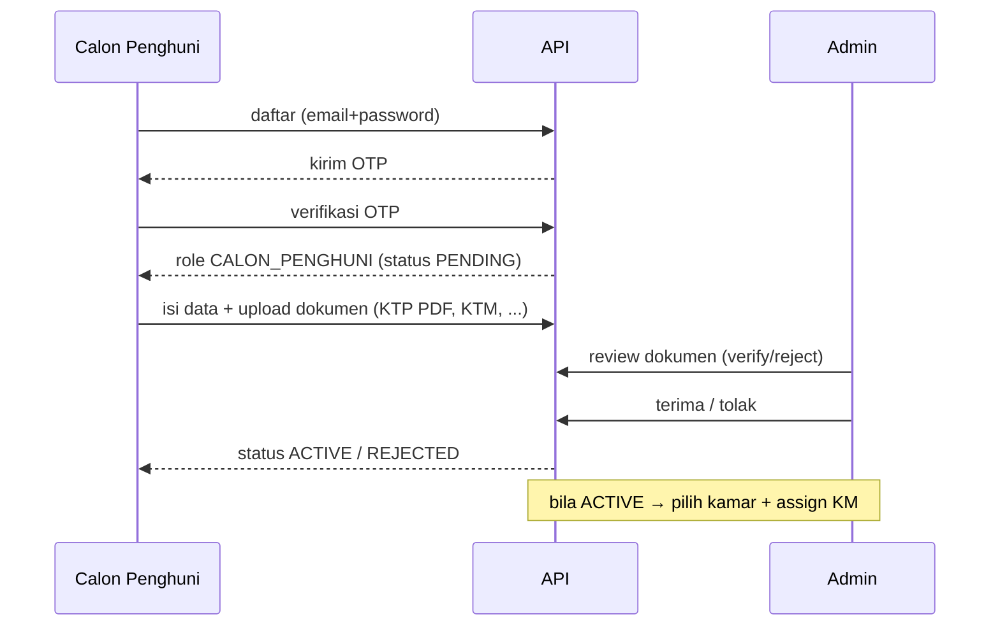

# Plan — Backend Asrama Mahasiswa Kepulauan Riau (Yogyakarta) + RBAC + Kas + Organisasi + Kegiatan + Pemilihan

> **Dokumen ini adalah SUMBER KEBENARAN.** Urutan kerja: **plan → ERD → phases**.
> Kalau ada perubahan desain, ubah **plan dulu**, baru sinkronkan [`erd.md`](./erd.md) dan [`phases.md`](./phases.md).

---

## 1. Ringkasan proyek

Backend untuk **Asrama Mahasiswa Kepulauan Riau (Kepri) di Yogyakarta**.

- **2 gedung terpisah** (gender berbeda) — beda keuangan, aturan, dan pengurus.
- **Struktur kepengurusan (jabatan)** per periode — tiap jabatan punya akses.
- **Pemilihan ketua asrama** — kandidat dari warga, voting **1 warga 1 suara**.
- **Kegiatan** rutin (mis. **yasinan** mingguan) dan **kegiatan besar** (mis. **Hari Jadi Kepri**) — ada panitia, anggaran, **absensi per user**, dan dokumentasi/LPJ.
- **Iuran bulanan** (kas) — tagih tiap bulan, bisa cicil/multi-bulan.
- **Dokumen pendaftaran dinamis** — KTP (PDF), KTM, dll; berlaku untuk **calon maupun warga lama**.
- **RBAC** — menu + permission (resource+action), dengan scope gedung.
- **Tanpa denda**, **tanpa OAuth** (auth email + password + OTP).

---

## 2. Alur dokumen (proses kerja)

```
1. docs/plan.md    ← SUMBER (apa, kenapa, aturan)   [difinalkan lebih dulu]
2. docs/erd.md     ← TURUNAN (model data dari plan)
3. docs/phases.md  ← TURUNAN (langkah implementasi)
```

Aturan: implementasi tidak jalan sebelum plan & ERD konsisten.

Referensi endpoint: [`docs/api.md`](./api.md) (daftar semua API + izin + tujuannya).

---

## 3. Keputusan desain

| #   | Topik                    | Keputusan                                                                                                                                 | Alasan                             |
| --- | ------------------------ | ----------------------------------------------------------------------------------------------------------------------------------------- | ---------------------------------- |
| 1   | Batas data               | **Gedung (`Building`)** sebagai tenant                                                                                                    | keuangan & aturan berbeda          |
| 2   | Kewajiban vs bayar       | `Invoice` ↔ `Payment` via `PaymentAllocation`                                                                                             | cicilan & multi-bulan              |
| 3   | Identitas orang          | **Satu `User`** + multi-role (`UserRole`)                                                                                                 | penghuni bisa login                |
| 4   | Kas                      | **Ledger append-only** (`LedgerEntry`)                                                                                                    | jejak tak bisa hilang              |
| 5   | Uang                     | Integer IDR (tanpa desimal)                                                                                                               | hindari pembulatan                 |
| 6   | Periode iuran            | `periodYear` + `periodMonth` unik per penghuni                                                                                            | cegah dobel                        |
| 7   | RBAC                     | Menu di DB + permission terpisah (resource+action)                                                                                        | fleksibel                          |
| 8   | Scope akses              | `UserRole.buildingId` (null = semua gedung)                                                                                               | admin gedung terbatas              |
| 9   | Dokumen                  | `DocumentType` dinamis + `DocumentSubmission`; berlaku **calon & warga lama**                                                             | admin bisa minta kapan saja        |
| 10  | Fasilitas                | `ROOM` (jumlah) & `PUBLIC` (`ASSIGNED` ber-slot / `SHARED` bebas)                                                                         | KM ber-nomor; parkir bebas         |
| 11  | Delete                   | **Soft delete** semua; ledger & alokasi **immutable**                                                                                     | audit aman                         |
| 12  | OTP                      | **Stateless time-based** — `HMAC(secret, email+timeStep)`, TTL 5 mnt, grace ±1 step; **tanpa tabel**; hanya `User.emailVerified`          | hemat hit DB + cukup aman          |
| 13  | Waktu                    | `timestamptz`, TZ `Asia/Jakarta`                                                                                                          | satu lokasi                        |
| 14  | Integritas               | `idempotencyKey` + `AuditLog`                                                                                                             | anti-dobel & jejak                 |
| 15  | **Organisasi**           | Jabatan **terpisah dari Role**; 1 jabatan **bisa pilih role apa saja** (`Position.roleId`)                                                | struktur ≠ hak akses               |
| 16  | **Periode**              | Ada **periode kepengurusan** (`Period`, mis. 2025/2026 + SK)                                                                              | pergantian pengurus tercatat       |
| 17  | **Scope jabatan**        | Jabatan **per gedung** (mis. Koord. Gedung Putra) atau asrama-wide                                                                        | sesuai struktur                    |
| 18  | **Kegiatan**             | Rutin bisa **per gedung**; kegiatan besar **jadi satu** asrama-wide                                                                       | mis. Hari Jadi Kepri               |
| 19  | **Absensi**              | **Absensi per user** tiap pertemuan (mis. yasinan)                                                                                        | kehadiran tercatat                 |
| 20  | **Anggaran kegiatan**    | Diambil dari **kas** (`Expense` → `LedgerEntry`)                                                                                          | transparansi keuangan              |
| 21  | **Event dadakan**        | Event bisa dibuat **spontan** (ad-hoc) dengan field minimal (`title` + `startAt`); panitia/anggaran/sesi **opsional**; ditandai `isAdHoc` | kegiatan mendadak tetap tercatat   |
| 22  | **Pemilihan ketua**      | Modul `Election` + `ElectionCandidate` + `ElectionVote`; kandidat dari **warga aktif**; **1 warga 1 suara** (unik)                        | regenerasi kepengurusan demokratis |
| 23  | **Pemilih by role**      | Yang boleh memilih ditentukan **per role** (`ElectionEligibleRole`, default `PENGHUNI`) + wajib **`Occupancy` aktif** (tinggal di asrama) | tak perlu pilih orang satu-satu    |
| 24  | **Hasil direkam**        | Hasil di-_snapshot_ ke `ElectionResult` saat `CLOSED` (per kandidat: votes, %, rank)                                                      | riwayat & peringkat permanen       |
| 25  | **Tampil setelah tutup** | Hasil hanya muncul setelah `CLOSED`; **tanpa** snapshot daftar pemilih                                                                    | tak memengaruhi pemilih            |
| 26  | **Pengesahan**           | Admin menyetujui pemenang → buat `PositionAssignment` jabatan `KETUA` (boleh juga tetapkan langsung)                                      | ketua terpilih resmi               |
| 27  | **Harga kamar**          | **Per gedung** (semua kamar 1 gedung sama; putra ≠ putri) via `FeeRule.defaultMonthlyRate`; `Room` tanpa harga                        | hindari harga per-kamar yang mubazir |

---

## 4. Ruang lingkup

**In scope**

- Auth: register, OTP, login (JWT), `me`.
- RBAC: role, permission, menu, penugasan role + scope gedung.
- **Organisasi**: periode kepengurusan, jabatan, penugasan pengurus (jabatan ↔ role).
- Master: gedung, kamar, aturan biaya, fasilitas.
- Pendaftaran: calon penghuni, dokumen dinamis, verifikasi, approve/reject.
- Penempatan: `Occupancy` (+ bed label) & penugasan kamar mandi.
- Keuangan: tagihan bulanan, pembayaran, alokasi, kas (masuk/keluar).
- **Kegiatan**: event rutin & besar, sesi/pertemuan, panitia, absensi, anggaran, dokumentasi/LPJ.
- **Pemilihan**: pemilihan ketua asrama — kandidat dari warga, voting 1 warga 1 suara, hasil/hitungan.
- Laporan: tunggakan, saldo kas, pemasukan vs pengeluaran.
- Audit.

**Out of scope**

- OAuth / social login. Denda. Domain marketplace lama (`Venue`, dst).

---

## 5. Model data (ringkas 40 tabel)

> Detail + diagram: [`erd.md`](./erd.md).

| Kelompok       | Tabel                                                                                     |
| -------------- | ----------------------------------------------------------------------------------------- |
| Auth           | `User` (OTP **stateless**, tanpa tabel)                                                    |
| RBAC           | `Role`, `Permission`, `RolePermission`, `Menu`, `RoleMenu`, `UserRole`                    |
| **Organisasi** | `Period`, `Position`, `PositionAssignment`                                                |
| Struktur       | `Building`, `Room`, `FeeRule`                                                             |
| Penghuni       | `Occupancy`                                                                               |
| Fasilitas      | `Facility`, `RoomFacility`, `PublicFacility`, `PublicFacilityAssignment`                  |
| Billing        | `Invoice`, `InvoiceLine`, `Payment`, `PaymentAllocation`                                  |
| Kas            | `CashAccount`, `Category`, `Expense`, `LedgerEntry`                                       |
| Dokumen        | `DocumentType`, `File`, `DocumentSubmission`                                              |
| **Kegiatan**   | `Event`, `EventSession`, `EventCommittee`, `EventAttendance`, `EventAttachment`           |
| **Pemilihan**  | `Election`, `ElectionEligibleRole`, `ElectionCandidate`, `ElectionVote`, `ElectionResult` |
| Audit          | `AuditLog`                                                                                |

### Model uang

```
totalAmount = baseAmount − discountAmount          (tanpa denda)
paidAmount  = SUM(PaymentAllocation.amount)
status      = PAID (paid ≥ total) · PARTIAL (0 < paid < total) · ISSUED (0) · OVERDUE · VOID

Saldo kas   = openingBalance + SUM(LedgerEntry IN) − SUM(LedgerEntry OUT)
```

---

## 6. RBAC & Organisasi

### Konsep

- **Menu** → navigasi (`RoleMenu`).
- **Permission** → aksi `resource` + `action` (`RolePermission`).
- **Role** → kumpulan menu + permission.
- **UserRole** → user ↔ role, dengan **scope gedung**.
- **Position (jabatan)** → struktur kepengurusan; **menunjuk ke satu `Role`** sebagai sumber akses.
- **PositionAssignment** → siapa menjabat, pada **periode** apa, untuk **gedung** mana.

```
Position.roleId ──► Role ──► RolePermission/RoleMenu ──► akses
PositionAssignment(user, position, period, building)
```

### Role default

| Code             | Deskripsi                                            |
| ---------------- | ---------------------------------------------------- |
| `SUPER_ADMIN`    | Akses penuh, semua gedung. Kelola RBAC.              |
| `ADMIN_GEDUNG`   | Kelola penghuni/kamar/tagihan gedungnya.             |
| `BENDAHARA`      | Kelola pembayaran & kas gedungnya.                   |
| `PENGURUS`       | Role dasar pengurus (jabatan menimpanya bila perlu). |
| `CALON_PENGHUNI` | Daftar, upload dokumen, edit profil.                 |
| `PENGHUNI`       | Lihat tagihan/pembayaran sendiri + absensi.          |

### Jabatan default (seed) — _perlu koreksi kamu_

| Code                | Nama                     | Scope       |
| ------------------- | ------------------------ | ----------- |
| `KETUA`             | Ketua                    | asrama-wide |
| `WAKIL_KETUA`       | Wakil Ketua              | asrama-wide |
| `SEKRETARIS`        | Sekretaris               | asrama-wide |
| `BENDAHARA`         | Bendahara                | asrama-wide |
| `KOOR_GEDUNG`       | Koordinator Gedung       | per gedung  |
| `KOOR_ACARA`        | Koordinator Acara/Humas  | asrama-wide |
| `KOOR_KEBERSIHAN`   | Koordinator Kebersihan   | asrama-wide |
| `KOOR_PERLENGKAPAN` | Koordinator Perlengkapan | asrama-wide |

### Pohon menu (hierarkis, maks 2 level)

`Menu.parentId` menyusun hirarki; `sortOrder` mengatur urutan. Anotasi role per baris:
`(r)` = read-only · `*` = dibatasi `buildingId` · `(self)` = data sendiri · `(CLOSED)` = tampil setelah pemilihan ditutup.

```
1. Dashboard                   dashboard              /dashboard                 semua role

2. Data Master                 master                 –                          (parent)
   ├─ Gedung                   master.building        /master/buildings          SUPER_ADMIN, ADMIN_GEDUNG(r)
   ├─ Kamar                    master.room            /master/rooms              SUPER_ADMIN, ADMIN_GEDUNG*
   ├─ Fasilitas Kamar          master.roomFacility    /master/room-facilities    SUPER_ADMIN, ADMIN_GEDUNG*
   ├─ Fasilitas Umum           master.publicFacility  /master/public-facilities  SUPER_ADMIN, ADMIN_GEDUNG*
   ├─ Aturan Biaya             master.feeRule         /master/fee-rules          SUPER_ADMIN, BENDAHARA*
   └─ Kategori Kas             master.category        /master/categories         SUPER_ADMIN, BENDAHARA*

3. Penghuni                    resident               –                          (parent)
   ├─ Pendaftar/Calon          resident.applicant     /residents/applicants      SUPER_ADMIN, ADMIN_GEDUNG*
   ├─ Data Penghuni            resident.list          /residents                 SUPER_ADMIN, ADMIN_GEDUNG*, BENDAHARA(r*), PENGURUS(r*)
   ├─ Penempatan Kamar         resident.occupancy     /residents/occupancies     SUPER_ADMIN, ADMIN_GEDUNG*
   └─ Verifikasi Dokumen       resident.document      /residents/documents       SUPER_ADMIN, ADMIN_GEDUNG*

4. Keuangan                    finance                –                          (parent)
   ├─ Tagihan                  finance.invoice        /finance/invoices          SUPER_ADMIN, ADMIN_GEDUNG*, BENDAHARA*
   ├─ Pembayaran               finance.payment        /finance/payments          SUPER_ADMIN, BENDAHARA*, ADMIN_GEDUNG*
   ├─ Pengeluaran              finance.expense        /finance/expenses          SUPER_ADMIN, BENDAHARA*, PENGURUS*
   ├─ Buku Kas                 finance.cash           /finance/cash              SUPER_ADMIN, BENDAHARA*, ADMIN_GEDUNG(r*)
   └─ Laporan Keuangan         finance.report         /finance/reports           SUPER_ADMIN, BENDAHARA*, ADMIN_GEDUNG(r*)

5. Organisasi                  organization           –                          (parent)
   ├─ Periode                  organization.period    /organization/periods      SUPER_ADMIN (r: ADMIN_GEDUNG*, PENGURUS*)
   ├─ Jabatan                  organization.position  /organization/positions    SUPER_ADMIN (r: ADMIN_GEDUNG*, PENGURUS*)
   └─ Penugasan                organization.assign    /organization/assignments  SUPER_ADMIN (r: ADMIN_GEDUNG*, PENGURUS*)

6. Kegiatan                    event                  –                          (parent)
   ├─ Daftar Kegiatan          event.list             /events                    SUPER_ADMIN, ADMIN_GEDUNG*, PENGURUS*, PENGHUNI(r)
   ├─ Sesi/Agenda              event.session          /events/sessions           SUPER_ADMIN, ADMIN_GEDUNG*, PENGURUS*, PENGHUNI(r)
   ├─ Panitia                  event.committee        /events/committees         SUPER_ADMIN, PENGURUS*
   ├─ Absensi                  event.attendance       /events/attendance         SUPER_ADMIN, ADMIN_GEDUNG*, PENGURUS*, PENGHUNI(self)
   └─ Lampiran/LPJ             event.attachment       /events/attachments        SUPER_ADMIN, ADMIN_GEDUNG*, PENGURUS*

7. Pemilihan                   election               –                          (parent)
   ├─ Daftar Pemilihan         election.list          /elections                 SUPER_ADMIN, PENGURUS*, PENGHUNI(r)
   ├─ Kandidat                 election.candidate     /elections/candidates      SUPER_ADMIN, PENGURUS*
   ├─ Pemilih (eligible)       election.eligible      /elections/eligible        SUPER_ADMIN, PENGURUS*
   └─ Hasil                    election.result        /elections/results         SUPER_ADMIN, PENGURUS*, PENGHUNI(CLOSED)

8. Sistem                      system                 –                          (parent)
   ├─ Pengguna                 system.user            /system/users              SUPER_ADMIN
   ├─ Role                     system.role            /system/roles              SUPER_ADMIN
   ├─ Permission               system.permission      /system/permissions        SUPER_ADMIN
   ├─ Menu                     system.menu            /system/menus              SUPER_ADMIN
   └─ Audit Log                system.audit           /system/audit              SUPER_ADMIN

9. Akun Saya                   me                     –                          (parent, self-service)
   ├─ Profil Saya              me.profile             /me/profile                CALON_PENGHUNI, PENGHUNI, PENGURUS
   ├─ Tagihan Saya             me.invoice             /me/invoices               PENGHUNI
   ├─ Dokumen Saya             me.document            /me/documents              CALON_PENGHUNI, PENGHUNI
   ├─ Absensi Saya             me.attendance          /me/attendance             PENGHUNI
   └─ Pemilihan Saya           me.election            /me/elections              PENGHUNI
```

Total **9 menu root + 37 anak = 46 baris `Menu`**.

> **Fase 1 seed hanya 4 role default** — `SUPER_ADMIN` ("Admin Master"), `ADMIN_GEDUNG` ("Admin Gedung"), `PENGHUNI` ("Warga"), `CALON_PENGHUNI` ("Calon Penghuni"). `BENDAHARA` & `PENGURUS` menyusul (menu-nya sudah disiapkan di pohon di atas).
>
> **Sementara** (sampai `BENDAHARA`/`PENGURUS` di-seed) menu mereka **dilipat ke `ADMIN_GEDUNG`**: Aturan Biaya, Kategori Kas, Pembayaran, Pengeluaran, Panitia → admin dapat akses penuh (dibatasi gedungnya); Organisasi & Pemilihan → admin **read-only** (`r*`).

### Permission (resource × action)

```
resource: user, role, permission, menu, building, room, feeRule, facility, occupancy,
          document, invoice, payment, cash, category, report, audit, position, period,
          event, election
action  : CREATE, READ, UPDATE, DELETE, APPROVE, VERIFY, EXPORT
```

### Enforcement (dicek di backend)

RBAC tidak cukup disimpan — **setiap endpoint wajib dicek**. Prinsip:

- **Default-deny**: semua `/api/*` wajib `requireAuth` + `loadAccess`, **kecuali whitelist publik** (`/health`, `/api/auth/register`, `/login`, `/request-otp`, `/verify-otp`).
- **Per-route permission**: tiap route memasang `requirePermission(resource, action)`. Tersedia helper `crud(resource)` yang **auto-map action dari HTTP method** (`POST→CREATE`, `GET→READ`, `PATCH/PUT→UPDATE`, `DELETE→DELETE`).
- **Bypass**: `SUPER_ADMIN` otomatis lolos semua check (ditandai `req.access.isSuperAdmin`).
- **Scope gedung**: `requirePermission` cek izin; `buildingScope` cek data (admin gedung hanya gedungnya).
- **Anti-bolong**: ada **test coverage route** — gagal bila ada route non-publik tanpa penanda permission, + **test negatif** (role tanpa izin → 403).

Middleware:

```
src/middleware/permission.ts   → loadAccess, requirePermission, requireRole, crud(resource)
src/middleware/buildingScope.ts → resolveBuildingScope, assertBuildingAccess
```

---

## 7. Alur bisnis

### 7.1 Pendaftaran & penempatan



### 7.2 Penempatan kamar (`Occupancy`)

1. Admin pilih kamar → cek **kapasitas** & **gender** (user cocok `Building.gender`).
2. Buat `Occupancy` aktif + snapshot `monthlyRateSnapshot`.
3. Assign KM → `PublicFacilityAssignment` (KM No. + slot A/B/C/D).
4. Checkout → `Occupancy` ENDED + slot dibebaskan.

### 7.3 Keuangan (tagihan → bayar → kas)

```
Generate tagihan bulanan (Invoice: ISSUED)
   → pembayaran (Payment) → alokasi (PaymentAllocation) → PARTIAL/PAID
   → LedgerEntry IN ke CashAccount gedung
   → pengeluaran (Expense) → LedgerEntry OUT
   → laporan: tunggakan, saldo kas, pemasukan vs pengeluaran
```

### 7.4 Organisasi (kepengurusan)

```
Buat Periode (mis. 2025/2026, + SK)
   → buat/hl jadwal Jabatan (asrama-wide / per gedung) → hubungkan ke Role
   → tugaskan pengurus (PositionAssignment: user + position + period + building)
   → akses pengurus otomatis mengikuti Role jabatannya
```

### 7.5 Kegiatan

```
Buat Event (RUTIN per gedung / BESAR asrama-wide)
   → (opsional) sesi berulang (EventSession; mis. yasinan mingguan)
   → tetapkan panitia (EventCommittee)
   → tentukan anggaran (budgetAmount; realisasi via Expense → kas)
   → pelaksanaan + absensi per user (EventAttendance per sesi)
   → dokumentasi + LPJ (EventAttachment via File)
```

**Event dadakan (ad-hoc):** admin/pengurus bisa membuat event spontan dengan field minimal saja (`title`, `startAt`, scope/gedung) — `isAdHoc=true`. Panitia, sesi, anggaran, dan absensi bisa ditambahkan menyusul tanpa memblokir pembuatan event.

### 7.6 Fasilitas

- **ROOM** — terpasang di kamar + jumlah (Kasur ×2, Meja ×1).
- **PUBLIC / ASSIGNED** — ber-nomor + slot; 1 penghuni 1 tipe, 1 slot 1 orang.
- **PUBLIC / SHARED** — bebas (parkir, dapur, olahraga).

### 7.7 Pemilihan ketua asrama

```
Buat Election (DRAFT) → tentukan role pemilih (ElectionEligibleRole, default PENGHUNI)
   → daftar kandidat dari warga aktif (ElectionCandidate; visi/misi)
   → OPEN → warga eligible memilih 1 kandidat (ElectionVote)
   → CLOSED → hasil dihitung & direkam (ElectionResult: votes, %, rank)
   → admin setujui pemenang → PositionAssignment jabatan KETUA → status DONE
```

- Pemilih sah = punya **role eligible** (`ElectionEligibleRole`) **dan** punya **`Occupancy` aktif** (tinggal di asrama).
- **Kandidat boleh memilih** (mereka juga warga).
- **1 warga 1 suara** (`@@unique([electionId, voterId])`).
- Boleh **abstain** (`allowAbstain`), suara `candidateId = null`.
- **Hasil hanya muncul setelah `CLOSED`**; **tanpa** snapshot daftar pemilih.
- **Pengesahan:** admin menyetujui pemenang (atau menetapkan langsung) → jabatan `KETUA`.

---

## 8. Teknis

### Stack

- **Express 5**, **Prisma 7** (`prisma-client`) + `@prisma/adapter-pg` (PostgreSQL).
- **zod**, **jsonwebtoken**, **bcryptjs**, **nodemailer**.
- OTP **stateless** (HMAC turunan waktu) + **email queue in-memory** (tanpa Redis/DB).
- TypeScript strict, ESM, import `.ts` (`tsx`). Test `node --test`.

### Struktur modul (layered + manual DI)

```
src/
  repositories/  # akses prisma + type
  services/      # satu folder per modul
    <modul>/
      service.ts       # createXService({ deps })
      service.test.ts  # unit test (fake deps)
  controller/    # express handlers
  validations/   # zod
  routes/        # router + middleware
  middleware/    # auth, permission, buildingScope
  lib/           # jwt, password, mailer, storage, ledger, billing, errors
  container.ts   # rakit dependency
```

### Env

```
PORT=8080
JWT_SECRET=...
DATABASE_URL=postgresql://...
SMTP_HOST=            # kosong → OTP di-log ke console (non-produksi)
SMTP_PORT=587
SMTP_USER=
SMTP_PASS=
MAIL_FROM=

OTP_SECRET=           # kosong → fallback JWT_SECRET
OTP_TTL_SECONDS=300

DORMITORY_TZ=Asia/Jakarta
INVOICE_DUE_DAY=10
STORAGE_DRIVER=local  # local | s3
STORAGE_BUCKET=
STORAGE_ENDPOINT=
STORAGE_KEY=
STORAGE_SECRET=
MAX_UPLOAD_MB=5
```

### Email (OTP)

- **Provider: Gmail SMTP** (`smtp.gmail.com:587`) — kirim dari `nikoagustio@gmail.com` ke alamat mana pun; butuh **2FA + App Password** (bukan password akun).
- Alternatif: **Resend** (SMTP relay; kirim ke alamat lain perlu verifikasi domain), **Mailpit** (dev lokal), atau **console** (kosongkan `SMTP_HOST`).
- Pengiriman via **queue in-memory**; kegagalan SMTP hanya dicatat di log, tidak menggagalkan request.

### Akun dev (seed)

Non-produksi, password sama `Sewdaq123` (dari `demoUserSeeder`):

| Email               | Role            |
| ------------------- | --------------- |
| `admin@gmail.com`   | `SUPER_ADMIN`   |
| `gedung@gmail.com`  | `ADMIN_GEDUNG`  |
| `calon@gmail.com`   | `CALON_PENGHUNI`|
| `warga@gmail.com`   | `PENGHUNI`      |

Bootstrap admin dari `userSeeder` pakai `SEED_ADMIN_EMAIL`/`SEED_ADMIN_PASSWORD`.

### Pola penulisan

1. Skema → migrasi (`npm run db:migrate -- --name ...`).
2. Repository → 3. Service → 4. Validations → 5. Controller → 6. Routes.
3. Wiring `container.ts`. 8. Test. 9. `npm run typecheck && npm test`.

Aturan: `asyncHandler` semua handler, error via `AppError`, query filter `deletedAt: null`, input divalidasi zod.

---

## 9. Fase implementasi (ringkas)

Detail: [`phases.md`](./phases.md).

| Fase | Isi                                                             | Status |
| ---- | --------------------------------------------------------------- | ------ |
| 0    | Bersihkan legacy (OAuth + marketplace)                          | ✅     |
| 1    | RBAC                                                            | ✅     |
| 2    | Building                                                        | ✅     |
| 3    | Room                                                            | ✅     |
| 4    | FeeRule                                                         | ✅     |
| 5    | Facility + RoomFacility                                         | ✅     |
| 6    | PublicFacility + Assignment                                     | ✅     |
| 7    | User lifecycle                                                  | ✅     |
| 8    | Dokumen + Storage                                               | ✅     |
| 9    | Occupancy                                                       | ✅     |
| 10   | Billing                                                         | ✅     |
| 11   | Kas                                                             | ✅     |
| 12   | **Organisasi (Period, Position, PositionAssignment)**           | ✅     |
| 13   | **Kegiatan (Event, sesi, panitia, absensi, anggaran, LPJ)**     | ✅     |
| 14   | **Pemilihan (Election, EligibleRole, Candidate, Vote, Result)** | ✅     |
| 15   | Audit                                                           | ✅     |
| 16   | Laporan                                                         | ✅     |
| 17   | Integrasi & test menyeluruh                                     | ✅     |
| 18   | Email Queue + OTP Stateless                                     | ✅     |

---

## 10. Asumsi & pertanyaan terbuka

| #   | Topik                                | Default diasumsikan                                     | Status           |
| --- | ------------------------------------ | ------------------------------------------------------- | ---------------- |
| 1   | `DocumentType` per gedung?           | per gedung                                              | perlu konfirmasi |
| 2   | `Category` global/per gedung?        | **per gedung** (diputuskan Fase 11)                     | ✅ selesai       |
| 3   | Status `OVERDUE`                     | dipertahankan (tanpa denda)                             | perlu konfirmasi |
| 4   | Penghuni pindah gedung?              | tidak (gender harus cocok)                              | perlu konfirmasi |
| 5   | **Iuran kegiatan** (Hari Jadi Kepri) | **masuk tagihan** (`InvoiceLine` kind `EVENT`)          | perlu konfirmasi |
| 6   | **Kegiatan berulang** (yasinan)      | **pakai `EventSession`** (Event = seri, sesi per pertemuan; `generateSessions`) — diputuskan Fase 13 | ✅ selesai |
| 7   | **Pengumuman/notifikasi** kegiatan   | **belum** ada tabel; dianggap fase lanjutan             | perlu konfirmasi |
| 8   | **Periode** asrama-wide?             | **ya** (1 periode aktif; jabatan gedung menempel ke situ — diputuskan Fase 12) | ✅ selesai |
| 9   | Jumlah slot KM                       | dari `capacity` atau input manual?                      | perlu konfirmasi |
| 10  | Fasilitas SHARED                     | perlu `capacity` (mis. parkir 20)?                      | perlu konfirmasi |

---

## 11. Changelog keputusan

1. Awalnya marketplace booking venue + payment gateway.
2. Berubah jadi **asrama bulanan**, lalu jadi **Asrama Mahasiswa Kepulauan Riau di Yogyakarta**.
3. OAuth dihapus; auth = email+password+OTP.
4. `Resident` dilebur ke `User` (multi-role).
5. Denda dihapus.
6. Gedung jadi batas tenant (2 gedung terpisah).
7. RBAC: menu di DB + permission terpisah + scope gedung.
8. Soft delete semua; ledger & alokasi immutable.
9. Dokumen dinamis (berlaku calon & warga lama).
10. Fasilitas ROOM vs PUBLIC (ASSIGNED ber-slot / SHARED bebas).
11. **Tambah modul Organisasi** (periode, jabatan ↔ role, penugasan per gedung).
12. **Tambah modul Kegiatan** (rutin/besar, sesi, panitia, absensi, anggaran dari kas, LPJ).
13. **Perbaikan proses**: plan jadi sumber kebenaran, ERD & phases diturunkan darinya.
14. **Event dadakan (ad-hoc)**: event bisa dibuat spontan (`isAdHoc`) dengan field minimal; perencanaan menyusul.
15. **Modul Pemilihan**: pemilihan ketua asrama oleh warga (kandidat + voting 1 suara).
16. **Pemilih by role**: eligibility ditentukan per role (`ElectionEligibleRole`) + `Occupancy` aktif; hasil direkam (`ElectionResult`) & tampil setelah `CLOSED`.
17. **RBAC enforcement**: default-deny + guard global (whitelist publik) + `requirePermission` per route + bypass `SUPER_ADMIN` + test coverage route.
18. **Pohon menu hierarkis** (`parent→child`, maks 2 level): 9 root + 37 anak = 46 baris `Menu`, dengan anotasi role per baris (menggantikan matriks flat).
19. **Role seed fase awal = 4 default** (`SUPER_ADMIN`, `ADMIN_GEDUNG`, `PENGHUNI`, `CALON_PENGHUNI`); `BENDAHARA` & `PENGURUS` menyusul.
20. **OTP stateless** (HMAC turunan waktu, TTL 5 mnt) — tabel `OtpCode` dihapus; email dikirim via **queue in-memory** (tanpa Redis/DB).
21. **Provider email = Gmail SMTP** (`smtp.gmail.com:587`, App Password) — bisa kirim ke alamat mana pun dari akun Gmail; Resend jadi alternatif (butuh verifikasi domain).
22. **Room** pakai **partial unique `[buildingId, number] WHERE deletedAt IS NULL`** via SQL mentah (Prisma tak mendukung partial unique) — nomor kamar bisa dipakai ulang setelah soft delete; `countActiveOccupants` ditunda ke Fase 9 (butuh `Occupancy`).
23. **Harga per gedung, bukan per kamar**: `Room.monthlyRate` dihapus. Semua kamar dalam 1 gedung berharga sama; **putra ≠ putri**. Harga diatur `FeeRule.defaultMonthlyRate` (Fase 4) + `effectiveFrom` (riwayat); di-snapshot ke `Occupancy.monthlyRateSnapshot` saat penempatan.
24. **Perbaikan RBAC**: `userRoleRepository.assign` idempotent — penugasan role yang sudah di-revoke (soft delete) bisa di-assign ulang tanpa error (reactivate baris lama).
25. **FeeRule = harga per gedung** (Fase 4): resource permission **`feeRule`** & **`category`** ditambahkan (126 → **140** permission); `ADMIN_GEDUNG` dapat `feeRule.*`. Seed: G1 350.000, G2 400.000.
26. **Occupancy** (Fase 9): satu occupancy aktif per user — **partial unique `[userId] WHERE status='ACTIVE' AND deletedAt IS NULL`** via SQL mentah; `place` cek kapasitas + kecocokan gender gedung + snapshot `monthlyRateSnapshot` dari `FeeRule` aktif; `checkout` set `ENDED` + bebaskan slot `PublicFacilityAssignment` (`usageMode ASSIGNED`). Status `User` **tidak** diubah oleh checkout occupancy (ditangani `resident.checkout` terpisah).
27. **Billing** (Fase 10): `baseAmount` di-snapshot dari `Occupancy.monthlyRateSnapshot`; `Invoice` **partial unik `[userId, periodYear, periodMonth] WHERE deletedAt IS NULL`** (boleh regenerate setelah soft delete); `generateMonthly` **idempotent** (skip periode yang sudah ada); `recordPayment` idempotent via `Payment.idempotencyKey` + alokasi otomatis oldest-first (`allocate`); `PaymentAllocation` immutable. `Payment.cashAccountId` masih scalar (relasi `CashAccount` + posting `LedgerEntry IN` di Fase 11).
28. **Kas** (Fase 11): **satu akun kas per gedung** (partial unik `[buildingId] WHERE deletedAt IS NULL`); `Category` **per gedung** (partial unik `[buildingId, name]`); `LedgerEntry` **immutable** (koreksi via entri `REVERSAL` **wajib alasan**, izin `cash.UPDATE`); `Expense` **wajib bukti** (`receiptFileId`) & tanpa edit/hapus (koreksi via reversal). **Pemasukan manual** (bantuan/donasi) = `LedgerEntry` IN `sourceType ADJUSTMENT` + kategori INCOME. **Integrasi atomik**: `billing.recordPayment` menulis Payment + Allocation + Invoice + `LedgerEntry IN` dalam **satu `$transaction`** (`runTransaction` + repo terima tx client); auto-resolve akun kas & kategori "Iuran" gedung. Transfer antar akun **ditunda**; izin pakai resource `cash`/`category` yang ada.
29. **Organisasi** (Fase 12): `Position` **terpisah dari `Role`** (`roleId` = sumber akses opsional); kode jabatan unik **per gedung** (partial unik `COALESCE(buildingId,'') + code`); hanya **1 `Period` aktif** (diaktifkan lewat `activatePeriod` transaksional); penugasan **struktur saja** — `assignPosition` **tidak** auto-grant `UserRole` (ditunda sampai role `BENDAHARA`/`PENGURUS` ada). `endAssignment` = `isActive=false` + `endDate` + soft delete (partial unik `[periodId, positionId, userId]` → boleh ditugaskan ulang). Izin: `period` READ-only untuk `ADMIN_GEDUNG` (kelola = SUPER_ADMIN), `position` CRUD untuk `ADMIN_GEDUNG` **dalam scope gedungnya** (jabatan asrama-wide = SUPER_ADMIN). Seed 9 jabatan; `roleId` null bila role belum ada.
30. **Kegiatan** (Fase 13): `createEvent` meng-resolve `scope` (default `ASRAMA`; `GEDUNG` bila ada `buildingId`, wajib divalidasi) + `category` default `RUTIN`; **auto-buat 1 `EventSession` bila `recurrence=NONE`**, kegiatan berulang isi sesi via `generateSessions(dates[])`. `recordEventExpense` **delegasi ke `cash.recordExpense`** (idempotency + `LedgerEntry` + kas) dengan `Expense.eventId` (kini **relasi FK**, bukan scalar); `scope=GEDUNG` → kategori pengeluaran wajib segedung. **Visibilitas**: user tanpa `event.UPDATE` hanya melihat event `isPublic=true` + absensi/panitia diri sendiri. Partial unik `WHERE deletedAt IS NULL` untuk sesi/panitia/absensi.
31. **Pemilihan** (Fase 14): pemilih sah = **role eligible** (`ElectionEligibleRole`, default `PENGHUNI`) **dan** `Occupancy` aktif; kandidat juga warga aktif. `closeElection` menghitung & menyimpan `ElectionResult` (votes/%; rank; abstain ikut) dalam **satu transaksi**; hasil hanya terbaca saat `CLOSED`/`DONE`. `finalize` **wajib `Election.periodId`**, menutup penugasan KETUA aktif periode itu lalu membuat penugasan baru, status → `DONE`. Partial unik: `ElectionCandidate [electionId, userId] WHERE deletedAt IS NULL`, **1 `OPEN` per scope** `COALESCE(buildingId,'') WHERE status='OPEN' AND deletedAt IS NULL`. `ElectionVote`/`ElectionResult` **immutable**. `ADMIN_GEDUNG.election` = CRUD dalam scope gedung.
32. **Audit** (Fase 15): `AuditLog` **immutable** (tanpa `deletedAt`). Helper `auditRequest(req, meta)` mencatat `actorId` (`req.user`) + `ip` (`req.ip`) & **tidak pernah melempar** (audit gagal ≠ operasi gagal). Field sensitif (`password`/`token`/`secret`) di-`redact` di service. Dipanggil dari controller RBAC & keuangan (cashAccount, category, expense, ledger income/reversal, payment). Baca via `GET /api/audit-logs` (izin `audit.READ`, menu `system.audit`).
33. **Audit otomatis** (Fase 15.1): middleware `auditMutations` mencatat **semua mutasi** (`POST/PUT/PATCH/DELETE` sukses) oleh `SUPER_ADMIN`/`ADMIN_GEDUNG` — `entity`/`action` dari **marker permission** route, `entityId` dari `data.id`, `path` = `originalUrl`, `after` = body respons. `auditRequest` menandai `req.__audited` agar log manual (kaya `before`/`after`) tidak dobel. Kolom `AuditLog.path` ditambahkan. GET & aktor non-admin tidak dicatat.
34. **Laporan** (Fase 16): laporan **read-only** (tanpa skema baru) — agregasi dari `Invoice`/`LedgerEntry`/`CashAccount`/`Expense`. `arrears` (tunggakan: `outstanding = total − paid`, status `ISSUED`/`PARTIAL`/`OVERDUE`), `cashBalances` (`opening + in − out` per akun), `incomeVsExpense` (net + rincian kategori, filter `from`/`to`), `eventBudgetRealization` (anggaran vs realisasi + `usagePercent`/`overBudget`). Cakupan gedung via `resolveBuildingScope`. Izin `report.READ`/`report.EXPORT` (menu `finance.report`); ekspor CSV via `src/lib/csv.ts`. Endpoint di `/api/reports`.
35. **Lifecycle penghuni** (Fase 17): `approve` (PENDING→ACTIVE) otomatis memberi role **`PENGHUNI`** ke user (idempoten, `buildingId` scope null seperti demo warga; `CALON_PENGHUNI` tetap dipertahankan untuk akses dokumen). Menutup celah: penghuni baru tidak bisa membaca tagihan sendiri & tidak memenuhi syarat pemilih. Akses tetap dari `UserRole` (jabatan = struktur saja, Fase 12).

---

## 12. Glossary

| Istilah                                   | Arti                                                                    |
| ----------------------------------------- | ----------------------------------------------------------------------- |
| **Gedung (`Building`)**                   | Unit terpisah (gender, kas, aturan) di dalam asrama.                    |
| **Periode (`Period`)**                    | Masa bakti kepengurusan (mis. 2025/2026).                               |
| **Jabatan (`Position`)**                  | Posisi struktural; menunjuk ke `Role` untuk akses.                      |
| **PositionAssignment**                    | Penugasan orang pada jabatan + periode + gedung.                        |
| **Occupancy**                             | Penempatan penghuni di kamar.                                           |
| **Event**                                 | Kegiatan (rutin/besar).                                                 |
| **Event dadakan**                         | Event ad-hoc/spontan (`isAdHoc`), dibuat dengan field minimal.          |
| **EventSession**                          | Pertemuan/pertemuan ulang dari sebuah Event (absensi menempel di sini). |
| **EventCommittee**                        | Panitia kegiatan.                                                       |
| **EventAttendance**                       | Absensi kehadiran user per sesi.                                        |
| **Election**                              | Pemilihan ketua (periode waktu buka–tutup).                             |
| **ElectionEligibleRole**                  | Role yang berhak memilih pada sebuah pemilihan (default `PENGHUNI`).    |
| **ElectionCandidate**                     | Calon ketua (dari warga aktif).                                         |
| **ElectionVote**                          | Suara warga (1 warga 1 suara; bisa abstain).                            |
| **ElectionResult**                        | Hasil final per kandidat (votes, %, rank), direkam saat `CLOSED`.       |
| **Invoice / Payment / PaymentAllocation** | Tagihan / uang masuk / pemetaan bayar.                                  |
| **LedgerEntry / Reversal**                | Entri kas append-only / entri koreksi.                                  |
| **RBAC**                                  | Role-Based Access Control (menu + permission).                          |
| **Scope gedung**                          | Pembatasan akses role/jabatan ke gedung tertentu.                       |
